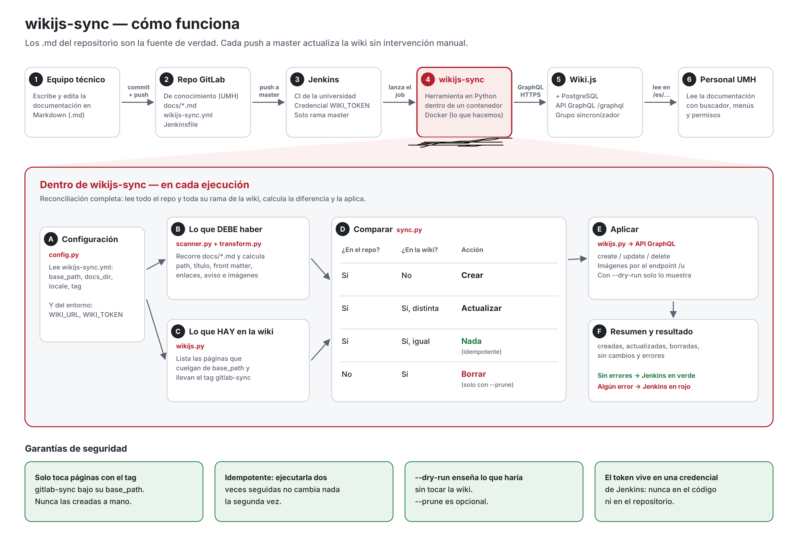

# Guía de uso: conecta tu repositorio con la wiki




Esta guía explica, paso a paso, cómo conectar el repositorio de tu equipo con
Wiki.js para que tu documentación se publique sola.

Cuando termines, cada vez que hagas push de tus `.md`, tu documentación aparecerá
(o se actualizará) automáticamente en la wiki, en la zona de tu equipo.

## El ciclo automático

```
┌─────────────┐      ┌─────────────┐      ┌─────────────┐      ┌─────────────┐
│  Editar .md │ ───► │  git push   │ ───► │   Jenkins   │ ───► │  Wiki.js   │
│  en el repo │      │  al repo    │      │  sincroniza │      │ actualizada │
└─────────────┘      └─────────────┘      └─────────────┘      └─────────────┘
```

Tú solo editas tus ficheros Markdown y haces push. El resto es automático.

---

## Antes de empezar: qué necesitas

- Un repositorio en el GitLab de la universidad con tu documentación.
- Tus ficheros Markdown (`.md`) dentro de una carpeta `docs/`.
- Que el equipo de la wiki te haya dado:
  - La **ruta de tu equipo** en la wiki (tu `base_path`, p.ej. `conocimiento/sistemas/redes`).
  - Acceso para que el pipeline pueda escribir en esa ruta (lo configura quien
    administra la wiki; tú no tienes que hacer nada con el token).

Si no tienes la ruta o el acceso, pídelos antes de seguir.

---

## Paso 1: organiza tu documentación en `docs/`

Pon tus ficheros Markdown dentro de una carpeta `docs/` en la raíz del repositorio:

```
mi-repo/
  docs/
    index.md
    instalacion.md
    ...
```

Reglas útiles que conviene conocer:
- `index.md` (o `README.md`) dentro de una carpeta se convierte en la página de esa carpeta.
- El nombre del fichero define la dirección de la página en la wiki (sin extensión,
  en minúsculas, sin acentos ni espacios: `Guía de Uso.md` -> `guia-de-uso`).
- Puedes poner un bloque de metadatos al principio de cada `.md` (opcional):
  ```
  ---
  title: Título de la página
  description: Una frase que describe la página
  tags: [etiqueta1, etiqueta2]
  ---
  ```
- Para publicar una página en otro idioma, añade un sufijo al nombre: `index.ca.md`
  (catalán), `index.en.md` (inglés). Sin sufijo = idioma por defecto.

---

## Paso 2: crea el fichero `wikijs-sync.yml`

En la raíz del repositorio, crea un fichero `wikijs-sync.yml` con la configuración
de tu equipo:

```yaml
base_path: conocimiento/sistemas/redes   # LA RUTA DE TU EQUIPO (te la dan)
docs_dir: docs                           # la carpeta con tus .md
locale: es                               # idioma por defecto
tag: gitlab-sync                         # no lo cambies (marca las páginas gestionadas)
```

Solo tienes que ajustar `base_path` con la ruta que te hayan asignado. El resto
suele dejarse igual.

---

## Paso 3: añade el pipeline

Tienes dos opciones según el sistema de CI que uses: **Jenkins** o **GitLab CI**.

### Opción A: Jenkins (recomendado en la UMH)

En la raíz del repositorio, crea un fichero `Jenkinsfile`:

```groovy
pipeline {
    agent {
        docker {
            image 'python:3.12-slim'
            args '-u root'
        }
    }

    environment {
        WIKI_URL   = 'http://URL-DE-LA-WIKI'       // Te la da el administrador
        WIKI_TOKEN = credentials('wikijs-token')   // Configurado en Jenkins
        HERRAMIENTA_URL = 'https://gitlab.umh.es/RUTA/wikijs-sync.git'
    }

    stages {
        stage('Instalar herramienta') {
            steps {
                sh '''
                    apt-get update && apt-get install -y --no-install-recommends git
                    pip install --quiet "git+${HERRAMIENTA_URL}"
                '''
            }
        }

        stage('Sincronizar con Wiki.js') {
            steps {
                sh 'python -m wikijs_sync --config wikijs-sync.yml'
            }
        }
    }

    post {
        success { echo 'Sincronización completada.' }
        failure { echo 'Error. Revisa el log.' }
    }
}
```

Hay una plantilla completa con más comentarios en `templates/Jenkinsfile`.

**Requisitos en Jenkins** (lo configura el administrador):
- Plugin "Docker Pipeline" instalado.
- Credencial `wikijs-token` con el token de la API de Wiki.js.
- Job de tipo "Pipeline script from SCM" apuntando a tu repo.

### Opción B: GitLab CI

En la raíz del repositorio, crea un fichero `.gitlab-ci.yml` que incorpora la
plantilla compartida de la herramienta:

```yaml
include:
  - project: 'GRUPO/wikijs-sync'                 # repo de la herramienta
    ref: v1                                       # versión de la plantilla
    file: '/templates/wikijs-sync.gitlab-ci.yml'  # la plantilla
```

Con estas tres líneas, tu repositorio hereda todo el proceso de sincronización.
No tienes que copiar ni entender la lógica; solo incluirla.

(Pregunta a quien administra la herramienta cuál es la ruta exacta del `project`
y el `ref` a usar.)

---

## Paso 4: haz push y comprueba

```bash
git add .
git commit -m "Conecta la documentación con la wiki"
git push
```

Al hacer push a la rama principal:
1. **Jenkins** (o GitLab CI) detecta el cambio y ejecuta el pipeline.
2. La herramienta lee tus `.md` y los publica en la wiki, bajo tu `base_path`.
3. Cuando el pipeline esté en verde, abre la wiki y comprueba tus páginas.

**Dónde ver el pipeline:**
- **Jenkins**: en el job correspondiente a tu repo, sección "Build History".
- **GitLab CI**: en tu proyecto, Build → Pipelines.

---

## Qué ocurre a partir de ahora

- Cada push a la rama principal **actualiza** tu zona de la wiki.
- Si **editas** un `.md`, su página se actualiza.
- Si **borras** un `.md`, su página se elimina de la wiki.
- **No edites las páginas directamente en la wiki**: se generan desde el repositorio
  y los cambios hechos a mano se perderían en la siguiente sincronización. Cada página
  lleva un aviso recordándolo.

---

## Problemas frecuentes

| Problema | Causa probable | Solución |
|----------|----------------|----------|
| El pipeline falla con error de permisos | La ruta (`base_path`) o el token no están bien | Contacta con el administrador de la wiki |
| No veo mi página en la wiki | Falta el prefijo de idioma en la URL | Usa `/es/...` o `/ca/...` según el idioma |
| El pipeline no se ejecuta | Falta el `Jenkinsfile` o `.gitlab-ci.yml` | Comprueba que está en la raíz del repo |
| Error "locale not found" | El idioma no está activado en la wiki | Pide que activen el idioma (ej: `ca` para valenciano) |
| Página editada en la wiki se pierde | Las páginas se generan desde el repo | Edita siempre el `.md` en el repo, no en la wiki |

---

## Opciones avanzadas de la herramienta

Puedes añadir opciones al comando de sincronización en el Jenkinsfile:

```groovy
sh 'python -m wikijs_sync --config wikijs-sync.yml --prune --verbose'
```

| Opción | Qué hace |
|--------|----------|
| `--dry-run` | Simula la sincronización sin tocar la wiki (para probar) |
| `--prune` | Borra de la wiki las páginas que ya no existen en el repo |
| `--verbose` | Muestra más información durante la ejecución |

**Nota sobre `--prune`**: si no usas esta opción, las páginas borradas del repo
seguirán en la wiki hasta que alguien las borre manualmente. Esto es más seguro
pero requiere limpieza manual de vez en cuando.

---

## Resumen (lo mínimo que tienes que hacer)

1. **`docs/`** con tus ficheros `.md`.
2. **`wikijs-sync.yml`** con tu `base_path`.
3. **`Jenkinsfile`** (o `.gitlab-ci.yml`) con el pipeline.
4. **`git push`** y comprobar el pipeline y la wiki.

---

## Plantillas disponibles

En el repositorio de la herramienta (`wikijs-sync/templates/`) hay plantillas listas para copiar:

| Fichero | Para qué sirve |
|---------|----------------|
| `Jenkinsfile` | Pipeline de Jenkins (recomendado en la UMH) |
| `wikijs-sync.gitlab-ci.yml` | Pipeline de GitLab CI |
| `ejemplo-repo-conocimiento.gitlab-ci.yml` | Ejemplo completo para un repo de documentación |
